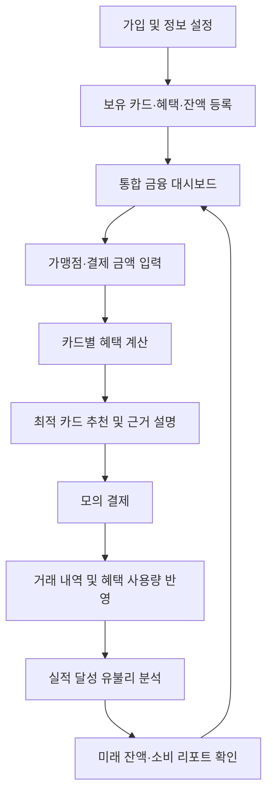
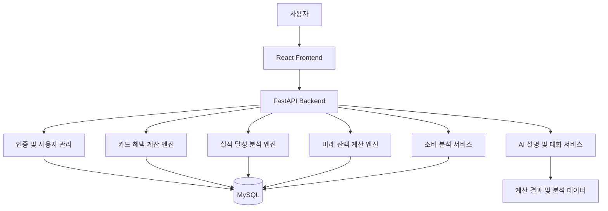

# YAMU (야무)

> **결제는 간편하게, 혜택은 야무지게.**
>
> 카드 혜택과 소비 패턴을 분석해 최적의 결제 카드를 추천하고, 실적 달성의 유불리와 미래 잔액까지 관리하는 AI 기반 통합 금융 플랫폼

---

## 목차

- [1. 프로젝트 개요](#1-프로젝트-개요)
- [2. 기획 배경 및 문제 정의](#2-기획-배경-및-문제-정의)
- [3. 서비스 목표 및 차별성](#3-서비스-목표-및-차별성)
- [4. 타깃 사용자](#4-타깃-사용자)
- [5. 핵심 기능](#5-핵심-기능)
- [6. 사용자 흐름](#6-사용자-흐름)
- [7. 화면 구성](#7-화면-구성)
- [8. AI 활용 전략](#8-ai-활용-전략)
- [9. 기술 스택](#9-기술-스택)
- [10. 시스템 아키텍처](#10-시스템-아키텍처)
- [11. 데이터베이스 설계 초안](#11-데이터베이스-설계-초안)
- [12. MVP 개발 범위](#12-mvp-개발-범위)
- [13. 개발 일정](#13-개발-일정)
- [14. 성공 지표](#14-성공-지표)
- [15. 구현 시 고려사항](#15-구현-시-고려사항)

---

## 1. 프로젝트 개요

| 항목 | 내용 |
|---|---|
| 프로젝트명 | 야무 (YAMU) |
| 서비스 분야 | 핀테크 · AI 기반 개인 금융관리 |
| 핵심 타깃 | 여러 카드를 사용하며 혜택과 소비를 효율적으로 관리하고 싶은 20~30대 |
| 핵심 가치 | 최적의 결제 선택, 합리적인 소비, 통합 금융관리 |
| 핵심 기능 | AI 카드 추천, 실적 달성 유불리 분석, 혜택 관리, 미래 잔액 예측 |
| 차별성 | 실적을 무조건 채우도록 유도하는 대신, 실적 달성이 실제로 유리한지 분석 |

### 한 줄 소개

야무는 여러 카드의 혜택과 사용 실적, 소비 내역을 통합 분석해 결제 상황에 가장 유리한 카드를 추천하고, 사용자가 놓치기 쉬운 혜택과 미래 잔액까지 관리하도록 돕는 AI 금융 플랫폼이다.

야무는 단순히 소비를 기록하는 가계부가 아니다. 결제 전에는 더 유리한 카드를 선택하도록 돕고, 결제 후에는 혜택과 소비 흐름을 분석해 다음 금융 행동까지 제안한다.

## 2. 기획 배경 및 문제 정의

### 문제 1. 카드가 많을수록 최적의 결제가 어렵다

카드마다 할인 업종, 적립률, 월 한도, 최소 실적 조건이 다르다. 사용자는 결제할 때마다 혜택 조건을 직접 비교해야 하며, 최적의 카드를 선택하기 어렵다.

### 문제 2. 실적을 채우는 것이 항상 이득은 아니다

실적이 부족하면 혜택을 놓칠까 봐 계획에 없던 소비를 하기도 한다. 그러나 실적 달성에 필요한 추가 지출이 실제로 받을 혜택보다 크다면 오히려 손해일 수 있다.

### 문제 3. 실적과 혜택을 제때 관리하기 어렵다

현재 실적, 남은 실적, 혜택 한도, 실적 마감일을 각각 확인해야 하므로 받을 수 있는 혜택을 놓치기 쉽다.

### 문제 4. 현재 잔액만으로 미래 소비를 판단하기 어렵다

현재 잔액을 알고 있어도 예정된 월세, 통신비, 생활비 등을 고려하지 않으면 월말 자금 부족에 대비하기 어렵다.

### 핵심 인사이트

사용자에게 필요한 것은 금융 정보의 단순한 나열이 아니라, 실제 소비 상황에서 활용할 수 있는 의사결정 지원이다.

- 지금 결제할 때 어떤 카드를 사용하는 것이 가장 유리한가?
- 남은 실적을 채우는 것이 실제로 이득인가?
- 이번 달 혜택을 얼마나 받았고, 앞으로 얼마나 받을 수 있는가?
- 예정된 지출을 고려하면 미래 잔액은 얼마나 남을까?

야무는 위 질문에 데이터 기반의 답을 제공하는 **의사결정 중심 금융 서비스**를 지향한다.

## 3. 서비스 목표 및 차별성

| 구분 | 일반적인 금융관리 서비스 | 야무 |
|---|---|---|
| 결제 | 카드별 혜택을 직접 확인 | 결제 조건에 맞는 카드 추천 |
| 실적 | 현재 실적과 잔여 금액 표시 | 실적 달성의 유불리 분석 |
| 소비 관리 | 지출 내역과 카테고리 제공 | 소비 패턴 기반 행동 가이드 |
| 혜택 | 할인·적립 내역 확인 | 추가 혜택과 필요한 비용 비교 |
| 잔액 | 현재 잔액 확인 | 예정 수입·지출 기반 미래 잔액 예측 |
| AI | 단순 질의응답 | 검증된 계산 결과를 바탕으로 추천 이유 설명 |

### 핵심 차별점

**야무는 혜택을 많이 받게 하는 데 그치지 않고, 혜택을 얻기 위해 불필요한 소비를 하지 않도록 돕는다.**

## 4. 타깃 사용자

### 페르소나 A. 혜택을 놓치기 싫은 직장인

- 나이: 27세
- 상황: 신용카드 3장과 체크카드 1장 사용
- 불편함:
  - 카드별 할인 조건과 잔여 한도를 외우기 어렵다.
  - 결제할 때마다 어떤 카드를 써야 할지 고민한다.
  - 받을 수 있는 혜택을 놓치면 아깝다고 느낀다.
- 야무가 제공하는 가치: 결제 상황에 맞는 카드와 예상 혜택을 빠르게 확인한다.

### 페르소나 B. 실적과 생활비 사이에서 고민하는 사회초년생

- 나이: 24세
- 상황: 월급과 고정 지출을 관리해야 하는 사회초년생
- 불편함:
  - 카드 실적을 채우려고 계획에 없던 소비를 한 경험이 있다.
  - 현재 잔액은 알지만 월말까지 얼마나 남을지 확신하기 어렵다.
  - 여러 앱에서 실적과 지출을 따로 확인한다.
- 야무가 제공하는 가치: 실적 달성의 유불리를 분석하고, 예정 지출과 미래 잔액을 함께 확인한다.

## 5. 핵심 기능

### 5.1. 야무픽 — AI 최적 카드 추천

**목표:** 결제 상황에 맞는 최적의 카드를 추천한다.

주요 기능:

- 보유 카드 및 카드별 혜택 조건 등록·관리
- 가맹점 업종과 결제 금액 입력
- 할인율, 적립률, 전월 실적, 잔여 한도 분석
- 카드별 예상 혜택 계산 및 순위 제공
- 추천 이유와 차선 카드 비교
- 모의 결제 후 거래 내역과 혜택 사용량 반영

#### 사용 시나리오

사용자가 카페에서 15,000원을 결제하려고 한다. 야무는 등록된 카드의 카페 할인율, 실적 조건, 잔여 한도를 확인하고 예상 혜택이 가장 큰 카드를 추천한다.

| 카드 | 혜택 조건 예시 | 예상 혜택 |
|---|---|---:|
| A카드 | 카페 10% 할인, 잔여 한도 충분 | 1,500원 할인 |
| B카드 | 카페 2% 적립 | 300원 혜택 |

> 위 금액은 기능 설명을 위한 가상 데이터다. 실제 계산 시 카드별 약관, 할인 한도, 실적 조건 등을 반영한다.

**구현 원칙:** 카드 혜택 규칙 엔진이 금액을 계산하고, AI는 계산 결과와 추천 이유를 설명한다.

### 5.2. 실적체크 — 소비 패턴 기반 실적 달성 판단

**목표:** 실적을 채우는 것이 유리한지, 추가 소비를 하지 않는 것이 유리한지 판단한다.

주요 기능:

- 카드별 전월 실적 기준, 현재 인정 실적, 잔여 실적 표시
- 실적 산정 기간과 마감일 관리
- 과거 소비 패턴과 예정 지출을 바탕으로 남은 기간의 예상 소비 계산
- 실적 달성 시 새롭게 얻을 수 있는 혜택 계산
- 추가 혜택과 추가 지출 비용 비교
- `실적 달성 추천`, `자연 소비 유지`, `추가 소비 비추천` 가이드
- 실적 미달 가능성이 높은 경우 알림 제공

#### 분석 로직

1. 카드 약관을 기준으로 현재 인정 실적과 남은 실적을 계산한다.
2. 과거 거래 내역과 예정 지출을 바탕으로 남은 기간의 자연 소비를 추정한다.
3. 자연 소비만으로 실적을 달성할 수 있는지 판단한다.
4. 실적 달성으로 새롭게 얻는 혜택을 계산한다.
5. 추가 소비가 필요한 경우, 소비의 필요성과 예상 혜택을 비교한다.
6. 분석 결과에 따라 추천 행동과 판단 근거를 제공한다.

#### 사용 시나리오

| 항목 | 가상 데이터 |
|---|---:|
| 전월 실적 기준 | 400,000원 |
| 현재 인정 실적 | 320,000원 |
| 남은 실적 | 80,000원 |
| 월말까지 예상되는 자연 소비 | 50,000원 |
| 실적 달성 시 추가 혜택 | 5,000원 |

**분석 결과 예시**

> 현재 실적이 80,000원 부족하지만, 월말까지 예상되는 일반 소비는 약 50,000원이에요. 추가로 30,000원의 실적이 부족할 수 있어요. 실적 달성만을 위해 불필요한 지출을 늘리기보다는 예정된 소비를 확인해 보세요. 추가 지출이 필요한 경우에는 그 비용과 추가 혜택을 비교하는 것이 좋아요.

#### 판단 기준

- **실적 달성 추천:** 예정된 소비로 실적을 채울 수 있거나, 원래 필요했던 지출을 해당 카드로 결제하는 것이 유리한 경우
- **자연 소비 유지:** 현재 소비 계획을 유지하면서 실적 달성 가능성을 관찰하는 것이 적절한 경우
- **추가 소비 비추천:** 혜택을 얻기 위해 필요하지 않은 소비를 해야 하고, 그 비용이 추가 혜택보다 큰 경우

> 실적 부족 금액 자체를 손실로 간주하지 않는다. 실적 미달로 놓치는 혜택, 추가 소비의 필요성, 해당 소비에서 얻는 할인·적립, 카드 약관상 실적 인정 여부를 함께 고려한다.

### 5.3. 잔고예보 — 미래 잔액 예측

**목표:** 현재 잔액과 예정 수입·지출을 바탕으로 미래 자금 흐름을 예측한다.

주요 기능:

- 현재 잔액 및 예정 수입·지출 등록
- 월세, 통신비, 구독료 등 반복 지출 관리
- 날짜별 예상 잔액 그래프
- 잔액 부족 가능성이 있는 시점 표시
- 생활비 사용 추세 기반 가이드

#### 계산 예시

현재 잔액이 800,000원이고 예정 지출이 450,000원이라면, 해당 기간에 추가 수입이나 다른 지출이 없다는 가정하에 예상 잔액은 350,000원이다.

**구현 원칙:** 잔액은 수입·지출 계산 로직으로 산출하고, AI는 결과의 의미와 소비 대안을 설명한다.

### 5.4. 소비리포트 — 소비 패턴 분석

**목표:** 소비 내역을 이해하고 다음 달의 소비 계획으로 연결한다.

주요 기능:

- 식비, 카페, 교통, 쇼핑 등 카테고리별 지출 분석
- 월별 소비 비교 및 소비 추이 시각화
- 카드별 할인·적립 혜택 요약
- 반복 지출과 비정기 지출 구분
- AI 맞춤 소비 피드백 제공

#### 사용 예시

> 이번 달 카페 지출이 지난달보다 18% 증가했어요. 카페 할인으로 받은 혜택은 7,200원이에요.

지출 변화와 혜택을 함께 보여줘 소비 규모뿐 아니라 소비 효율도 파악할 수 있도록 한다.

### 5.5. 야무톡 — 대화형 금융 가이드

**목표:** 사용자가 금융 데이터를 자연어로 질문하고 이해할 수 있도록 돕는다.

주요 기능:

- “지금 어떤 카드가 유리해?”와 같은 자연어 질문
- 카드 실적과 잔여 혜택 요약
- 실적 달성의 유불리에 대한 근거 기반 답변
- 잔액과 예정 지출을 바탕으로 한 소비 가이드
- 소비 리포트에 대한 후속 질문

#### 사용 예시

**사용자:** 이번 달 외식을 해도 괜찮을까?

**야무:** 현재 잔액, 예정 지출, 설정한 생활비를 바탕으로 가능한 소비 범위와 예상 잔액을 설명한다.

> AI는 실제 계산 결과와 사용자 데이터를 근거로 답변한다. 데이터가 부족한 경우에는 추정치와 한계를 명확히 안내한다.

## 6. 사용자 흐름

핵심 사용자 경험은 **결제 전 선택 → 결제 후 관리 → 다음 소비 계획**으로 이어지는 순환 구조다.

## 7. 화면 구성

| 화면 | 주요 구성 |
|---|---|
| 홈 | 보유 카드, 실적 요약, 남은 혜택, 소비 요약, 잔액 예보 |
| 야무픽 | 가맹점·금액 입력, 카드별 혜택 비교, 추천 근거, 모의 결제 |
| 실적체크 | 실적 달성률, 잔여 실적, 예상 소비, 달성 유불리 분석 |
| 잔고예보 | 날짜별 예상 잔액, 예정 수입·지출, 부족 예상 시점 |
| 소비리포트 | 카테고리별 지출, 월별 비교, 할인·적립 혜택, AI 피드백 |
| 야무톡 | 자연어 질문, 금융 데이터 기반 답변, 후속 질문 |
| 마이페이지 | 사용자 설정, 카드 관리, 알림 설정, 데이터 관리 |

### 권장 하단 메뉴

`홈` · `카드 추천` · `실적 관리` · `소비 분석` · `마이`

야무톡과 잔고예보는 홈과 각 상세 화면에서 진입하도록 구성해 메뉴가 지나치게 복잡해지지 않게 한다.

## 8. AI 활용 전략

야무는 AI가 모든 금융 계산을 직접 수행하는 구조가 아니라, **계산 엔진이 정확한 결과를 산출하고 AI가 그 결과를 해석해 설명하는 구조**로 설계한다.

| 기능 | 계산·분석 로직 | AI 역할 |
|---|---|---|
| 카드 추천 | 카드별 혜택 규칙 및 예상 할인·적립 계산 | 추천 이유 설명 |
| 실적체크 | 인정 실적, 예상 소비, 추가 혜택 계산 | 달성 유불리 및 행동 가이드 설명 |
| 잔고예보 | 현재 잔액 + 예정 수입 − 예정 지출 | 미래 잔액 변화 설명 |
| 소비리포트 | 카테고리별 지출 집계 및 기간 비교 | 소비 패턴 해석 |
| 야무톡 | 서비스 데이터 조회 및 계산 결과 활용 | 자연어 질의응답 |

### 실적 달성 유불리 판단 알고리즘

1. 카드 약관을 바탕으로 현재 인정 실적과 남은 실적을 계산한다.
2. 과거 거래 내역과 예정 지출을 바탕으로 남은 기간의 자연 소비를 추정한다.
3. 자연 소비만으로 실적을 달성할 수 있는지 판단한다.
4. 실적 달성으로 새롭게 얻는 혜택을 계산한다.
5. 추가 소비가 필요한 경우, 소비의 필요성과 추가 혜택을 비교한다.
6. 결과에 따라 추천 행동과 판단 근거를 제공한다.

### AI 적용 시 주의사항

- 금융 금액은 검증된 계산 로직에서 산출한다.
- AI에는 계산 결과와 판단 근거를 전달해 설명을 생성하도록 한다.
- 사용자 데이터와 카드 약관에 없는 사실을 임의로 생성하지 않도록 한다.
- 예상 소비와 미래 잔액은 추정치임을 명시한다.
- 데이터가 부족하면 단정적인 추천 대신 추가 정보가 필요하다고 안내한다.

## 9. 기술 스택

> 아래 기술 스택은 프로젝트 구현을 위한 권장안이며, 팀의 숙련도와 개발 환경에 따라 조정할 수 있다.

| 구분 | 기술 | 활용 목적 |
|---|---|---|
| Frontend | React, TypeScript | 사용자 인터페이스 및 컴포넌트 개발 |
| Styling | Tailwind CSS | 반응형 UI 및 스타일 관리 |
| Visualization | Chart.js | 소비 분석 및 잔액 예측 시각화 |
| Backend | FastAPI, Python, Pydantic | API 및 서비스 로직 개발 |
| Database | MySQL | 사용자·카드·혜택·거래 데이터 관리 |
| AI | LLM API, Python 데이터 분석 | 설명 생성, 소비 패턴 해석, 대화형 가이드 |
| Deployment | Docker | 컨테이너 기반 실행 환경 |
| CI/CD | GitHub Actions | 자동 빌드·테스트·배포 |
| Cloud | AWS 또는 팀 환경에 맞는 클라우드 | 서비스 배포 및 운영 |

## 10. 시스템 아키텍처

### 주요 컴포넌트

- **Frontend:** 사용자 입력, 카드 비교, 대시보드 및 분석 결과 시각화
- **Backend API:** 인증, 데이터 조회, 서비스 로직 연결
- **카드 혜택 계산 엔진:** 할인·적립·한도·실적 조건 계산
- **실적 분석 엔진:** 예상 소비와 추가 혜택을 바탕으로 실적 달성 유불리 분석
- **잔액 계산 엔진:** 현재 잔액과 예정 수입·지출을 기반으로 미래 잔액 계산
- **AI 서비스:** 계산 결과 설명, 소비 패턴 해석, 자연어 질의응답
- **Database:** 사용자, 카드, 혜택, 거래, 실적, 예정 수입·지출 저장

## 11. 데이터베이스 설계 초안

| 테이블 | 주요 역할 |
|---|---|
| `users` | 사용자 정보 및 설정 |
| `cards` | 등록 카드 기본 정보 |
| `card_benefits` | 할인·적립률, 실적 조건, 한도, 적용 조건 |
| `transactions` | 거래 날짜, 금액, 가맹점, 카테고리, 카드 |
| `monthly_performance` | 월별 인정 실적과 목표 실적 |
| `benefit_usage` | 혜택별 사용 금액과 잔여 한도 |
| `scheduled_cashflows` | 예정 수입·지출 및 반복 주기 |
| `performance_analysis` | 예상 소비, 달성 가능성, 추천 행동 및 분석 근거 |
| `notifications` | 실적 마감 및 잔액 관련 알림 |
| `ai_reports` | 소비 분석과 AI 설명 결과 |

### 데이터 설계 원칙

- 카드 기본 정보와 혜택 규칙을 분리한다.
- 거래 내역과 혜택 사용량을 구분해 관리한다.
- 카드별 실적 제외 항목과 할인 한도를 반영할 수 있도록 설계한다.
- 예측값과 확정 거래를 구분한다.
- 사용자별 데이터 접근 권한을 검증한다.

## 12. MVP 개발 범위

### P0 — 필수 구현

- [ ] 카드 등록 및 샘플 혜택 데이터 관리
- [ ] 가맹점·금액 기반 최적 카드 추천
- [ ] 추천 근거와 예상 혜택 표시
- [ ] 전월 실적 및 잔여 한도 계산
- [ ] 소비 패턴 기반 실적 달성 유불리 분석
- [ ] 모의 결제 및 거래 내역 반영

### P1 — 핵심 경험 보강

- [ ] 미래 잔액 예측 및 시각화
- [ ] 실적 미달·잔액 부족 알림
- [ ] 월별 소비 리포트
- [ ] AI 추천 이유 및 소비 피드백

### P2 — 확장 기능

- [ ] 대화형 금융 가이드
- [ ] 외부 금융 데이터 연동
- [ ] 실제 결제 사업자 연계 검토
- [ ] 개인화된 소비 예측 고도화

## 13. 개발 일정

### 4주 개발 일정 예시

| 주차 | 주요 작업 | 산출물 |
|---|---|---|
| 1주 차 | 요구사항 확정, 화면 설계, DB 모델링, 샘플 혜택 데이터 구축 | 기획서, ERD, UI 설계 |
| 2주 차 | 카드 등록 API, 혜택 계산 엔진, 카드 추천, 실적 판단 로직 | 핵심 API 및 계산 테스트 |
| 3주 차 | 대시보드, 실적 관리 화면, 잔고예보, 소비 리포트 | 주요 화면 및 통합 기능 |
| 4주 차 | AI 연동, 통합 테스트, 배포, 시연 시나리오 작성 | 배포 서비스, 테스트 결과, 발표 자료 |

개발 기간이 짧다면 카드 추천과 실적 판단을 우선 완성하고, 나머지 기능은 샘플 데이터 기반으로 간소화한다.

## 14. 성공 지표

| 평가 영역 | 측정 지표 |
|---|---|
| 카드 추천 | 테스트 케이스에서 추천 카드 및 예상 혜택 계산의 정확성 |
| 실적 판단 | 인정 실적과 실적 달성 판단이 검증된 규칙과 일치하는 비율 |
| 소비 예측 | 예상 소비와 실제 기록의 오차 |
| 잔고예보 | 예정 수입·지출을 반영한 잔액 계산의 정확성 |
| 사용 편의성 | 추천 이유와 실적 분석 결과에 대한 사용자 이해도 |
| 핵심 플로우 | 카드 등록부터 추천 확인 및 모의 결제까지 완료하는 비율 |

목표 수치는 초기 테스트 데이터와 사용자 평가를 바탕으로 설정한다. 특히 카드 추천과 실적 유불리 판단은 정확성을 최우선으로 검증한다.

## 15. 구현 시 고려사항

### 실제 결제 연동

통합 바코드 결제와 자동 카드 선택에는 결제 사업자·카드사 연동 및 제휴 조건이 필요할 수 있다. MVP에서는 샘플 카드 데이터와 모의 결제를 기본으로 한다.

### 카드 혜택 데이터 정확성

카드별 공식 약관, 실적 제외 항목, 월별 한도, 할인 적용 조건을 반영해야 한다. 단순한 할인율 비교만으로는 실제 혜택을 정확히 계산할 수 없다.

### 실적 달성 유불리 판단

실적 부족 금액과 혜택 금액만 비교하지 않는다. 자연 소비, 예정 지출, 추가 소비의 필요성, 실적 미달로 놓치는 혜택을 함께 고려한다.

### AI 신뢰성

금융 금액은 검증된 계산 엔진에서 산출하고, AI는 계산 결과를 설명한다. 근거가 부족한 경우에는 단정적인 추천을 피한다.

### 데이터 보호

실제 금융 데이터 연동 전에는 인증·인가, 암호화, 최소 수집 원칙, 사용자별 데이터 접근 권한을 검토한다.

### 예측의 한계

미래 잔액과 예상 소비는 추정치다. 확정된 거래와 예측값을 명확히 구분하고, 사용자에게 예측의 전제와 한계를 안내한다.

---

## 프로젝트 핵심 요약

**야무는 결제 전에는 최적의 카드를 추천하고, 결제 후에는 실적과 혜택을 관리하며, 미래 소비까지 계획할 수 있도록 돕는 AI 기반 통합 금융 플랫폼이다.**

핵심 차별점은 단순히 혜택을 보여주는 것이 아니라, **실적을 채우는 것이 실제로 유리한지 분석해 불필요한 소비를 줄이는 것**이다.
