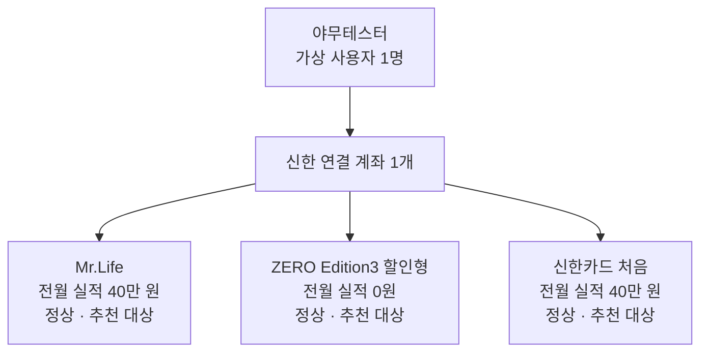

# 로컬 개발용 Seed

명령어 하나로 카드 상품·혜택과 **테스트 사용자 1명, 연결 계좌 1개, 보유 카드 3장**을 적재합니다.

## 만들어지는 사용자



야무테스터는 하나의 신한 계좌에 카드 3장을 연결한 가상 사용자입니다.
세 카드 모두 등록 완료·정상 상태입니다.
Mr.Life와 처음은 전월 실적 조건을 충족하고, ZERO는 실적 조건 없이 기본 할인을 받습니다.
**이번 달 거래, 실적, 혜택 사용량은 모두 0**으로 시작합니다.

## 준비되는 데이터

### 1. 사용자

| 항목 | 내용 |
|---|---|
| 테스트 사용자 | 야무테스터 1명 |
| 휴대폰 | 01000000001 (테스트용) |
| 생년월일 | 1995-01-01 (테스트용) |
| 간편 비밀번호(PIN) | 최초 실행 때 자동 생성 |

### 2. 연결 계좌·개인정보

| 항목 | 내용 |
|---|---|
| 연결 계좌 | 테스트 사용자 명의의 신한 SSAFY 계좌 1개 |
| 잔액 | 연결한 SSAFY 계좌의 잔액을 사용 |

### 3. 카드 상품·혜택

아래 혜택과 적용·제외 대상, 전월 실적 조건, 건별·일별·월별 한도를 준비합니다.

| 카드 | 지원 혜택 | 전월 실적 조건 | 주요 한도 |
|---|---|---|---|
| Mr.Life | 월납 공과금·편의점·병원/약국·세탁·야간 쇼핑/택시/식음료·주말 마트 10% 할인, 총 8개 | 30만 원 이상 | 건별 월납·주말 최대 5,000원, 생활·야간 최대 1,000원. 서비스별 횟수·월 한도 적용 |
| ZERO Edition3 할인형 | 대상 거래 0.8% 청구할인, 총 1개 | 없음 | 할인 금액·횟수 한도 없음 |
| 신한카드 처음 | 음식점·카페·편의점·온라인쇼핑 ‘오늘도 5%’ 적립, 총 4개 | 30만 원 이상 | 건별 최대 500P, 4개 혜택 합산 하루 1,000P, 월 공유 한도 적용 |

월 한도는 아래와 같습니다. Mr.Life의 편의점·병원/약국·세탁·야간 쇼핑/택시/식음료는
‘생활·야간’ 한도를 함께 사용합니다. 월납·생활/야간·주말 한도는 각각 별개입니다.

| 카드·서비스 | 전월 30만~50만 원 미만 | 전월 50만~100만 원 미만 | 전월 100만 원 이상 |
|---|---:|---:|---:|
| Mr.Life 월납 | 3,000원 | 7,000원 | 10,000원 |
| Mr.Life 생활·야간 | 10,000원 | 20,000원 | 30,000원 |
| Mr.Life 주말 | 3,000원 | 7,000원 | 10,000원 |
| 처음 오늘도 5% | 5,000P | 10,000P | 20,000P |

### 4. 보유 카드·사용 현황

세 카드는 위 사용자에게 각각 1장씩 연결되며, 같은 계좌를 출금 계좌로 사용합니다.

| 보유 카드 | 지난달 거래·실적 | 이번 달 거래·실적·혜택 사용량 | 초기 혜택 상태 |
|---|---|---|---|
| Mr.Life | 40만 원 거래 1건, 실적 40만 원 | 모두 0 | 실적 충족. 월납 3,000원·생활/야간 10,000원·주말 3,000원 한도 미사용 |
| ZERO Edition3 할인형 | 거래 없음, 실적 0원 | 모두 0 | 실적 조건 없이 기본 할인 대상 |
| 신한카드 처음 | 40만 원 거래 1건, 실적 40만 원 | 모두 0 | 실적 충족. 일 1,000P·월 5,000P 한도 미사용 |

모든 카드는 등록 완료·정상 상태입니다. 지난달·이번 달은 실행 시점의 한국 날짜를 기준으로 합니다.

## 최초 실행

1. **Docker Desktop을 실행**하고 JDK 17 이상이 설치되어 있는지 확인합니다.
2. 저장소 루트에서 PowerShell을 열고 개인 설정 파일을 준비합니다. 기존 파일은 덮어쓰지 않습니다.

   ```powershell
   cd be
   if (-not (Test-Path .\seed\.env.seed.local)) {
       Copy-Item .\seed\.env.seed.example .\seed\.env.seed.local
   }
   ```

3. `seed/.env.seed.local`은 본인의 금융망 정보를 넣는 개인 설정 파일입니다. 아래 세 항목을 입력합니다.

   | 항목 | 입력할 값 |
   |---|---|
   | `SEED_SSAFY_MEMBER_ID` | 준비한 SSAFY 금융망 사용자 ID |
   | `SEED_SSAFY_USER_KEY` | 해당 사용자의 금융망 userKey |
   | `SEED_ACCOUNT_NUMBER` | 해당 사용자 명의의 계좌번호 |

   은행 코드 `SEED_BANK_CODE`는 기본값 `088`(신한은행)을 그대로 사용합니다. 수정할 필요가 없습니다.
   입력할 SSAFY 사용자·계좌와 잔액 100만 원은 미리 준비합니다.

4. **`be` 폴더에서** 실행합니다. 앱 서버를 먼저 실행할 필요는 없습니다.

   ```powershell
   .\seed\load.ps1
   ```

   완료 메시지가 나오면 위 사용자·계좌·카드·혜택이 적재된 것입니다.
   실행에 필요한 키와 테스트 PIN은 자동 생성되어 같은 파일에 보관됩니다.
   이 개인 설정 파일은 Git에 올라가지 않습니다. 이후에도 삭제하지 않고 유지합니다.

## 기존 로컬 설정 파일을 쓰는 경우

이미 복사한 `application-local.yml`은 견본 수정으로 자동 갱신되지 않습니다.
`yamu.crypto.data-keys.[1]`이 빈 값이면 `${YAMU_CRYPTO_DATA_KEY_1:}` 참조로 바꾸고,
나머지 암호화 키와 JWT 설정도 최신 견본의 환경변수 참조를 확인하세요.
기존 키가 직접 입력돼 있다면 파일을 덮어쓰거나 키를 새로 만들지 말고,
Seed 설정의 키와 동일한지 먼저 확인하세요. 서로 다르면 기존 암호문을 복호화할 수 없습니다.
`load.ps1` 실행 후 같은 PowerShell에서 `bootRun`을 실행해야 내보낸 환경변수가 전달됩니다.

## 초기 상태로 복원 명령

앱 서버를 멈추고 **`be` 폴더에서** 실행합니다.

```powershell
.\seed\load.ps1 -Reset
```

테스트 사용자의 거래·실적·한도 사용량·기기 등록 내역 등을 초기화하고,
위에서 설명한 사용자·계좌·보유 카드와 지난달 거래 2건을 다시 만듭니다.
**다른 사용자, 카드 상품·혜택, SSAFY 계좌·잔액은 유지합니다.**
재생성된 사용자의 ID는 달라질 수 있습니다.
다이소를 보유한 이전 Seed 사용자도 이 명령으로 처음 카드 구성으로 바꿀 수 있습니다.

## 실행 옵션

| 명령 (`be` 폴더) | 동작 |
|---|---|
| `.\seed\load.ps1` | 최초 적재. 같은 카드 구성의 사용자가 있으면 진행 상태 유지 |
| `.\seed\load.ps1 -Reset` | 테스트 사용자를 위 초기 상태로 복원 |
| `.\seed\load.ps1 -CatalogOnly` | 사용자·계좌·보유 카드 없이 상품·혜택·가맹점만 적재. 금융망 개인 설정 불필요 |

`-Reset`과 `-CatalogOnly`는 함께 사용할 수 없습니다.

## 포함하지 않는 혜택

처음의 생활·여행·패션·정기결제·계획소비·즉시결제 혜택과 Mr.Life의 주유·인테이크몰은 포함하지 않습니다.
신규 발급 특례가 종료된 기존 카드 기준입니다. 기존 다이소 상품·약관 기록은 보존됩니다.
