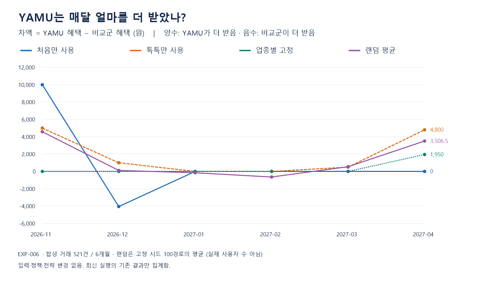
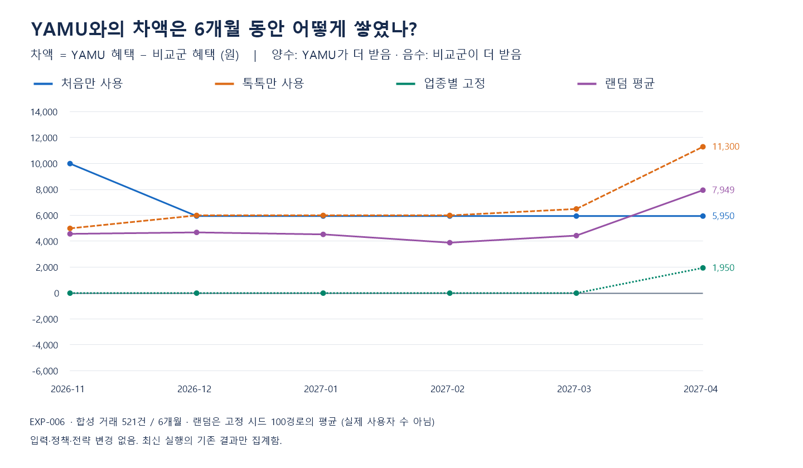

# EXP-006: YAMU를 쓰면 6개월 동안 얼마를 더 받았나

[실험 보고서](README.md) · [전체 집계표](runs/main-2026-11-13T08-12-30.835208800Z-001549c3-9328-424e-b65b-38762aadac1e/difference-analysis/tables.md) · [실험 색인](../README.md)

같은 거래 521건·소비액 5,609,000원에서 **YAMU의 6개월 혜택은 69,800원**이다. 비교군별로 더 받은 금액은 다음과 같다. 월평균이 아닌 **6개월 합계 차액**이다.

발표 문구는 **“선정한 두 카드와 6개월 합성 소비에서, YAMU는 톡톡만 사용했을 때보다 혜택을 11,300원, 약 19.3% 더 받았다”**로 정했다. 증가율은 `11,300 ÷ 58,500 × 100`을 반올림한 값이다. 소비액의 19.3%를 돌려받았다는 뜻이 아니다.

| 비교군 | 비교군의 6개월 혜택 | YAMU가 더 받은 금액 |
|---|---:|---:|
| 신한카드 처음만 사용 | 63,850원 | **5,950원** |
| KB국민 청춘대로 톡톡만 사용 | 58,500원 | **11,300원** |
| 업종별 고정 사용 | 67,850원 | **1,950원** |
| 균등 랜덤 100경로 평균 | 61,851원 | **7,949원** |

고정 사용은 실제로 모든 거래를 해당 카드 한 장으로 결제한 경로다. 실적을 채우기 위한 예외 배정이나 추가 거래는 없다. 업종별 고정은 카페를 톡톡, 나머지를 처음으로 결제한다. 랜덤 100개는 시드가 다른 선택 경로이며 사용자 100명의 데이터가 아니다.

## 월마다 생긴 차액

**차액 = 해당 월 YAMU 혜택 − 해당 월 비교군 혜택.** 양수는 YAMU가 더 받았다는 뜻이고, 음수는 비교군이 더 받았다는 뜻이다. 금액 단위는 원이다.

| 월 | 처음만 사용 대비 | 톡톡만 사용 대비 | 업종별 고정 대비 | 랜덤 평균 대비 |
|---|---:|---:|---:|---:|
| 2026-11 | 10,000 | 5,000 | 0 | 4,576 |
| 2026-12 | **−4,050** | 1,000 | 0 | 114.5 |
| 2027-01 | 0 | 0 | 0 | **−153** |
| 2027-02 | 0 | 0 | 0 | **−641.5** |
| 2027-03 | 0 | 500 | 0 | 546.5 |
| 2027-04 | 0 | 4,800 | 1,950 | 3,506.5 |



## 첫 달부터 쌓인 차액

각 월의 차액을 첫 달부터 합산했다. 누적 차액이 감소하는 달은 그 달에 비교군이 YAMU보다 더 받았다는 뜻이다. 금액 단위는 원이다.

| 월 | 처음만 사용 대비 | 톡톡만 사용 대비 | 업종별 고정 대비 | 랜덤 평균 대비 |
|---|---:|---:|---:|---:|
| 2026-11 | 10,000 | 5,000 | 0 | 4,576 |
| 2026-12 | 5,950 | 6,000 | 0 | 4,690.5 |
| 2027-01 | 5,950 | 6,000 | 0 | 4,537.5 |
| 2027-02 | 5,950 | 6,000 | 0 | 3,896 |
| 2027-03 | 5,950 | 6,500 | 0 | 4,442.5 |
| 2027-04 | **5,950** | **11,300** | **1,950** | **7,949** |



## 왜 증가하거나 멈추고, 줄었나

- **11월:** 초기 전월 실적이 두 카드 각각 40만 원이었다. YAMU와 업종별 고정은 처음 5,000원·톡톡 10,000원 혜택을 받아 총 15,000원으로 같았다. 처음만 사용은 5,000원, 톡톡만 사용은 10,000원이었다.
- **12월, 처음 대비 차액 감소:** 처음만 사용한 경로는 11월 인정 실적 1,004,200원으로 다음 달 처음 한도가 20,000원이 됐고, 12월 혜택 14,050원을 받았다. YAMU는 처음 실적이 982,200원이라 다음 달 한도가 10,000원이었고 이를 모두 사용했다. 톡톡은 실적 미달이었다. 그래서 YAMU가 4,050원 적게 받았고 누적 우위가 10,000원에서 5,950원으로 줄었다.
- **1~3월, 처음 대비 차액 정체:** YAMU와 처음만 사용 모두 처음의 월 한도 10,000원을 채웠다. 업종별 고정도 10,000원이었다. 거래별 차이는 있었지만 월 합계는 같아 누적 차액이 늘지 않았다.
- **1·2월, 랜덤 평균 대비 차액 감소:** YAMU는 톡톡 실적이 미달이고 처음 혜택은 월 10,000원에서 멈췄다. 여러 카드에 실적이 분산되는 기존 랜덤 경로들의 월평균 혜택은 각각 10,153원·10,641.5원으로 더 높았다. 시드별 실적과 결과를 그대로 집계했으며 어떤 시드가 유리한지 보고 선택을 바꾸지 않았다.
- **3월, 톡톡 대비 +500원:** 톡톡만 사용은 스타벅스 거래 19,000원의 50%인 9,500원을 받아 월 10,000원 한도를 다 쓰지 않았다. YAMU는 처음에서 10,000원을 받았다.
- **4월, 업종별 고정 대비 차액 발생:** YAMU와 업종별 고정 모두 처음의 월 한도 20,000원이 적용됐다. YAMU는 14,800원, 업종별 고정은 12,850원을 받아 한도가 남았다. 업종별 고정이 실적 미달 톡톡으로 결제한 카페 8건을 YAMU는 처음으로 결제했고, 이 8건의 혜택 합계가 1,950원 차이를 만들었다. 톡톡만 사용은 10,000원이어서 YAMU가 4,800원 높았다.

실적·한도 근거는 [월별 실적](runs/main-2026-11-13T08-12-30.835208800Z-001549c3-9328-424e-b65b-38762aadac1e/monthly-performance.csv), [거래별 차액](runs/main-2026-11-13T08-12-30.835208800Z-001549c3-9328-424e-b65b-38762aadac1e/transaction-differences.csv), [선택·후보 혜택·한도 원자료](runs/main-2026-11-13T08-12-30.835208800Z-001549c3-9328-424e-b65b-38762aadac1e/trades.zip)에서 확인할 수 있다. 12월 톡톡만 사용의 9,000원도 스타벅스 거래액 18,000원의 50%이며 한도 미소진이다.

## 랜덤 평균보다 높아도 모든 랜덤 경로보다 높지는 않았다

6개월 누적 차액의 범위는 **−9,300원~+19,750원**이었다. P05 −3,050원, 중앙값 +8,175원, 평균 +7,949원, P95 +17,000원이다. 100경로 중 **9개에서는 YAMU가 더 적게 받았고**, 91개에서는 더 많이 받았다. 동률은 없었다.

분포는 각 시드의 첫 달~해당 월 차액을 먼저 합한 뒤 계산했다. 월마다 좋은 시드를 골라 이어 붙이거나 월별 백분위 값을 더하지 않았다. [월별 누적 분포](runs/main-2026-11-13T08-12-30.835208800Z-001549c3-9328-424e-b65b-38762aadac1e/difference-analysis/random-cumulative-distribution.csv)와 [모든 경로별 차액](runs/main-2026-11-13T08-12-30.835208800Z-001549c3-9328-424e-b65b-38762aadac1e/difference-analysis/path-differences.csv)을 제공한다. P05·P95는 정렬한 100개 중 5번째·95번째다.

## 사용한 결과와 검산

- 실행 ID: `main-2026-11-13T08-12-30.835208800Z-001549c3-9328-424e-b65b-38762aadac1e`. 최신 생활비 EXP-006 결과만 사용했다.
- 입력: [고정 거래](frozen-transactions.json) 521건, 생성 시드 6006. 원 실행 manifest의 직렬화 입력 SHA-256은 `d8ad2899f3d9077e5966b08479ca456ef69476fc75de3be061df45321765dd66`이다.
- 정책: 2026-11-15 등록 스냅샷을 6개월 유지하는 기존 가정. 기준 커밋 `b26ebd944d47c5277260149c6096c67c70228596`와 원 실행의 소스 압축본·manifest를 사용한다.
- [집계 CSV](runs/main-2026-11-13T08-12-30.835208800Z-001549c3-9328-424e-b65b-38762aadac1e/difference-analysis/monthly-and-cumulative.csv)에 월별 혜택·차액·누적 혜택·누적 차액을 함께 기록했다.
- 103개 비교 경로 × 6개월에서 `월별 차액 합계 = 누적 YAMU 혜택 − 누적 비교군 혜택`을 확인했다. 각 경로의 6개월 합계는 원 실행 summary와 같고, 랜덤 평균의 누적 항등식도 일치했다. [검산 결과와 원자료 해시](runs/main-2026-11-13T08-12-30.835208800Z-001549c3-9328-424e-b65b-38762aadac1e/difference-analysis/validation.json).

재현은 저장소 루트에서 아래 집계 명령만 실행하면 된다. 새로운 실험·거래 재생은 필요 없다. PNG는 PowerShell/.NET System.Drawing으로 생성한다(Windows, 맑은 고딕).

```powershell
& docs/experiments/card-selection/exp-006-six-months/Analyze-Differences.ps1 -RunPath 'docs/experiments/card-selection/exp-006-six-months/runs/main-2026-11-13T08-12-30.835208800Z-001549c3-9328-424e-b65b-38762aadac1e'
```

입력·카드·정책·실적·전략은 변경하지 않았다. 이는 선정한 두 카드와 합성 소비에서의 결과이며 실제 사용자 평균이나 매월·장기 최적을 보장하지 않는다. 차액을 키우려고 실적 부족을 보충하지 않았다. 기존에 취소한 실사용자 후속 실험도 진행하지 않는다.
