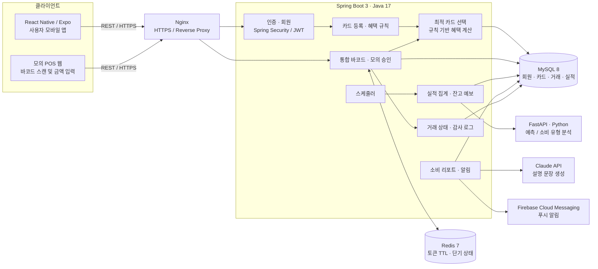
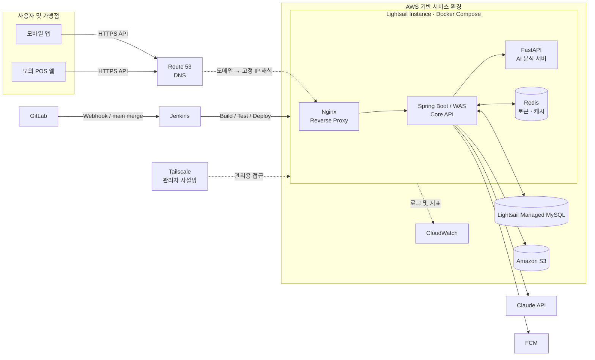
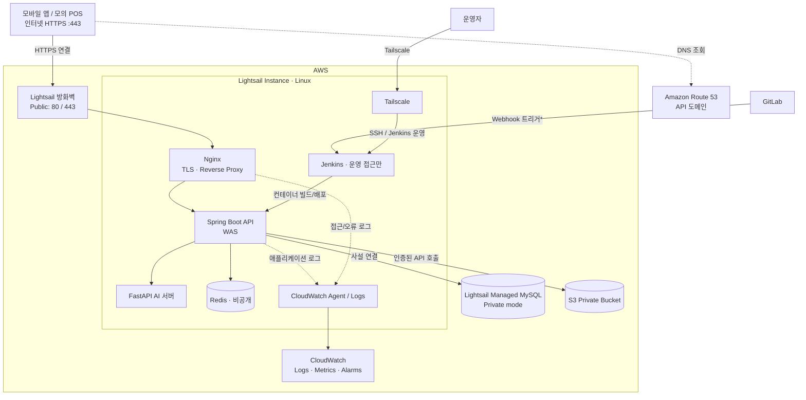
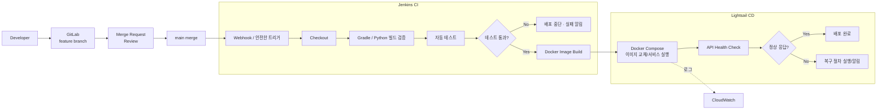
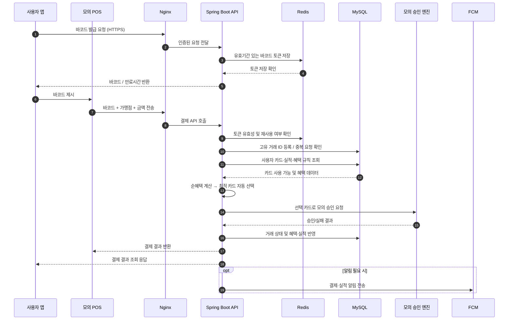
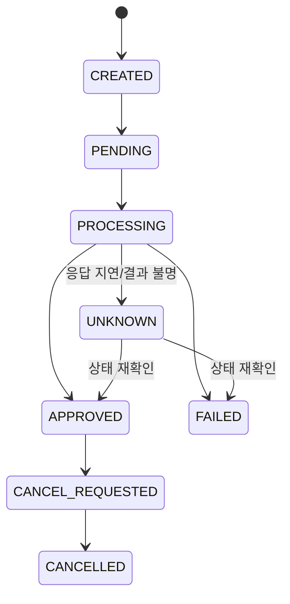
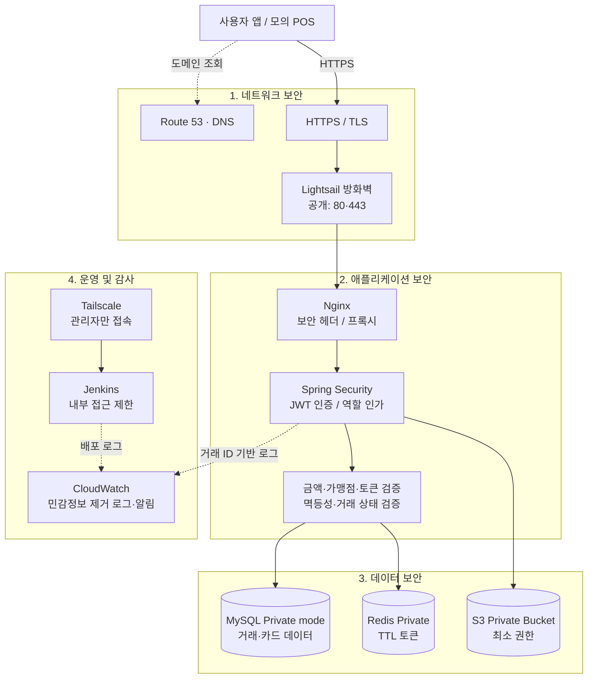

# YAMU Architecture

> **YAMU (야무)** — 결제는 간편하게, 소비는 야무지게  
> 통합 바코드 기반 최적 카드 자동 선택 · 모의 결제 · 소비 및 실적 관리

## 문서 안내

이 문서는 YAMU의 **애플리케이션, 전체 시스템, 인프라, CI/CD, 결제 시퀀스, 보안 아키텍처**를 GitLab/GitHub에서 바로 확인할 수 있도록 Mermaid 다이어그램과 설명으로 정리한 설계 문서입니다.

- **기준**: 7주 MVP, **실제 카드 승인 및 계좌 잔액 조회는 모의 데이터와 모의 승인 엔진으로 처리**
- **인프라 계획**: AWS Lightsail 단일 인스턴스, Lightsail Managed MySQL, S3, Route 53, Docker Compose, Nginx, Jenkins, Tailscale, CloudWatch
- **애플리케이션 설계**: React Native·Expo / Spring Boot 3·Java 17 / FastAPI / MySQL 8 / Redis 7 / Claude API / Firebase Cloud Messaging(FCM)
- **상태 구분**: 아래 그림은 **목표 설계**입니다. 배포 완료 여부, Redis 및 외부 서비스 연동 여부 등은 실제 구현 후 별도로 표기해야 합니다.

## 목차

1. [기술 스택](#1-기술-스택)
2. [애플리케이션 아키텍처](#2-애플리케이션-아키텍처)
3. [전체 시스템 아키텍처](#3-전체-시스템-아키텍처)
4. [인프라 아키텍처](#4-인프라-아키텍처)
5. [CI/CD 아키텍처](#5-cicd-아키텍처)
6. [결제 시퀀스 다이어그램](#6-결제-시퀀스-다이어그램)
7. [보안 아키텍처](#7-보안-아키텍처)
8. [운영 체크리스트](#8-운영-체크리스트)

---

## 1. 기술 스택

| 영역 | 기술 | 역할 |
| --- | --- | --- |
| 모바일 클라이언트 | React Native, Expo | Android/iOS 앱, 바코드 표시, 카드·결제 관리 |
| 테스트 가맹점 | 모의 POS 웹 | 바코드 스캔, 가맹점·결제금액 전달 |
| Web / Reverse Proxy | Nginx | HTTPS 종료, `/api` 등 요청 라우팅 |
| Backend / WAS | Spring Boot 3, Java 17 | 인증·인가, 카드·혜택·실적·모의 결제 로직 |
| Backend Security | Spring Security, JWT | 로그인, API 인증·인가 |
| AI Backend | Python, FastAPI | 소비 분석, 생활비 예측, 실적 달성 가능성 분석 |
| RDBMS | MySQL 8 (Lightsail Managed Database) | 사용자·카드·거래·규칙·실적 영속 저장 |
| 캐시 / 임시 상태 | Redis 7 *(설계안)* | 바코드 토큰 TTL, 요청 제한, 단기 상태 |
| 오브젝트 스토리지 | Amazon S3 | 이미지·파일 보관 |
| AI 문장화 | Claude API *(연동 계획)* | 카드 추천 이유·리포트 설명 생성 |
| 푸시 알림 | Firebase Cloud Messaging *(연동 계획)* | 실적 마감·잔액 부족 등 알림 |
| Cloud / DNS | AWS Lightsail, Route 53 | 애플리케이션 호스팅, DNS |
| Container / CD | Docker, Docker Compose, Jenkins | 컨테이너 실행과 자동 배포 |
| Version Control | GitLab | 브랜치, MR, Webhook |
| Private Administration | Tailscale | SSH·Jenkins 등 운영자 접근 제어 |
| Monitoring | CloudWatch | 인프라 지표, 애플리케이션 로그, 알림 |

> **구성 참고**: Spring Boot는 임베디드 Tomcat 같은 WAS를 사용해 실행될 수 있습니다. 그림의 `WAS / Spring Boot API`는 역할 구분이며, 반드시 별도의 WAS 컨테이너와 백엔드 컨테이너로 분리한다는 뜻은 아닙니다.

---

## 2. 애플리케이션 아키텍처



**핵심 설계**

- 최적 카드 선택과 혜택 산정은 **Spring Boot의 규칙 기반 엔진**에서 수행합니다. LLM이 결제 대상을 임의 결정하지 않습니다.
- Python AI 서버는 예측·분류 분석을 담당하며, Claude API는 추천 이유와 리포트의 **문장화**에 활용합니다.
- 카드 상태, 전월 실적 인정 규칙, 월 혜택 한도, 가맹점 업종을 함께 검증합니다.
- 실제 결제사업자 대신 **모의 승인 엔진**을 사용합니다.

---

## 3. 전체 시스템 아키텍처



**중요**: Route 53은 네트워크 요청을 직접 전달하는 프록시가 아니라 **DNS 이름을 IP에 연결하는 서비스**입니다. 클라이언트의 실제 HTTPS 연결은 도메인 조회 후 Nginx로 향합니다.

---

## 4. 인프라 아키텍처



### 인프라별 책임

| 구성요소 | 역할 | 보안/운영 원칙 |
| --- | --- | --- |
| Lightsail | 앱·AI·Redis 등 컨테이너 실행 | 서버 1대는 장애 시 서비스 전체에 영향 |
| Nginx | HTTPS 종료, 요청 라우팅 | 외부에 443 공개, 내부 API 포트는 비공개 |
| Spring Boot / WAS | API, 카드·결제 로직 | DB 트랜잭션과 요청 검증 |
| MySQL | 거래 영속 데이터 | Private mode, 백업·복구 검증 |
| Redis | 바코드 TTL·단기 상태 | 외부 포트 비공개, 영속 결제 결과의 단독 저장소로 사용 금지 |
| S3 | 파일/이미지 | 버킷 공개 차단·최소 권한 |
| Jenkins | CI/CD | UI는 운영망으로 제한 |
| Tailscale | 관리자 접속 | 관리자별 접근 정책 설정 |
| CloudWatch | 로그/모니터링 | 민감정보 제거, 경보 기준 수립 |

**단일 서버 제약**: Jenkins 빌드와 API가 한 서버에서 실행되면 리소스 경합이 발생할 수 있습니다. 동시 빌드를 제한하고, 장애 시 컨테이너 복구·DB 복구 절차를 따로 마련합니다.

**Webhook 주의**: GitLab SaaS에서 Jenkins에 직접 Webhook을 보내려면 네트워크 도달 경로가 필요합니다. Jenkins UI를 공개하는 대신 GitLab Runner, 내부 릴레이 또는 폴링 같은 안전한 트리거 방식을 선택할 수 있습니다. 배포 전 실제 네트워크 구성을 확정해야 합니다.

---

## 5. CI/CD 아키텍처



### 배포 정책

1. `feature/*` 브랜치에서 작업하고 MR 리뷰 후 `main`에 병합합니다.
2. Jenkins가 소스를 체크아웃해 빌드·단위 테스트를 수행합니다.
3. 테스트가 통과하면 컨테이너 이미지를 생성하고 Compose 기반으로 배포합니다.
4. 헬스체크 성공 시 배포를 완료합니다.
5. 실패 시 **이전 이미지 태그 복구 및 원인 확인**을 수행합니다. 자동 롤백은 스크립트·이미지 보관·검증 로직을 구현한 경우에만 가능합니다.
6. **DB 스키마 변경은 이미지만 되돌린다고 자동 복구되지 않으므로**, 마이그레이션 호환성 전략을 별도로 정의합니다.

---

## 6. 결제 시퀀스 다이어그램



### 실패 및 중복 결제 처리



- **멱등성**: 동일 결제 ID로 재요청되더라도 중복 승인되지 않도록 DB의 유일성 제약과 상태 검증을 함께 사용합니다.
- **바코드**: 짧은 TTL, 서버측 유효성 검증, 재사용 방지 및 결제 요청과의 연결이 필요합니다.
- **UNKNOWN**: 네트워크 타임아웃은 승인 실패와 다릅니다. 거래 상태를 확인한 뒤 후속 처리합니다.
- **실제 결제와 구분**: 현재 시퀀스의 `모의 승인 엔진`에서는 실제 금전 이동이 없습니다.

---

## 7. 보안 아키텍처



### 보안 통제 상세

| 영역 | 보안 통제 | 적용 방향 |
| --- | --- | --- |
| 네트워크 | HTTPS, Lightsail 방화벽 | 공개 포트 최소화, HTTP → HTTPS 전환 |
| 관리자 접속 | Tailscale | SSH, Jenkins에 대한 사설 접근 허용 |
| 인증·인가 | Spring Security + JWT | 사용자별 권한 및 데이터 소유권 확인 |
| 요청 검증 | 입력값 검증, 쿼리 파라미터 바인딩 | SQL Injection 등 입력 기반 공격 방지 |
| 웹 보안 | Nginx/Spring 보안 헤더·CORS·CSRF 정책 | 클라이언트 인증 방식에 맞춰 검토 |
| 카드정보 | 최소 수집, 마스킹, 비밀정보 저장 금지 | 실제 카드번호·CVC·비밀번호 저장 금지 |
| 토큰 | Redis TTL, 서버측 만료·재사용 검사 | 바코드 토큰 유효성 보장 |
| DB | Private mode, 계정 최소 권한 | 인터넷 직접 접근 차단 및 백업 점검 |
| S3 | Block Public Access, 최소 권한 | 필요 시 서버측 암호화 사용 |
| 로그 | 민감정보 제거, 거래 ID 추적 | 개인정보 및 인증 토큰을 로그에 출력하지 않음 |
| 모니터링 | CloudWatch 알림 | API 오류 증가, 비정상 접근 및 서버 장애 감지 |
| 배포 | Jenkins 자격 증명 관리 | 비밀번호·토큰을 저장소나 빌드 로그에 노출하지 않음 |

> **보안 주의**: Route 53은 방화벽이나 API 게이트웨이가 아닙니다. 또한 Lightsail Managed MySQL의 `Private mode`는 접근 통제를 의미하며, 모든 보안 요구사항을 자동으로 충족한다는 뜻이 아닙니다. `Redis`가 같은 서버 내 컨테이너라면 인터넷에 포트를 게시하지 않도록 설정합니다.

---

## 8. 운영 체크리스트

### 서버 · 네트워크
- [ ] Lightsail 인스턴스 발급 및 고정 IP 설정
- [ ] Docker / Docker Compose 설치
- [ ] Route 53 DNS 레코드 설정
- [ ] Nginx HTTPS 설정 및 인증서 자동 갱신
- [ ] 80/443 외 불필요한 공인 포트 차단
- [ ] Tailscale 설치 및 운영자별 접근제어

### 데이터 · 서비스
- [ ] Managed MySQL 생성 및 비공개 연결 확인
- [ ] S3 비공개 버킷 및 최소 권한 구성
- [ ] Redis 운영 여부 확정, 외부 포트 비공개 설정
- [ ] 바코드 TTL / 결제 멱등성 / 모의 승인 실패 시나리오 테스트
- [ ] DB 백업·복원 검증

### 자동 배포 · 모니터링
- [ ] GitLab → Jenkins 트리거 방식 검증
- [ ] 빌드·테스트·이미지 생성·배포 파이프라인 구현
- [ ] Health Check 및 배포 실패 시 복구 절차 구현
- [ ] CloudWatch 로그 수집 및 보관기간 설정
- [ ] 민감정보 로그 출력 방지 및 이상 요청 알림 검증

---

## 다이어그램과 원본 이미지 관리

GitLab/GitHub는 위 `mermaid` 코드 블록을 다이어그램으로 렌더링할 수 있습니다. 원본 PNG를 함께 관리하려면 저장소에 다음처럼 넣을 수 있습니다.

```text
repo/
├── ARCHITECTURE.md
└── docs/
    └── architecture/
        ├── application.png
        ├── system.png
        ├── infrastructure.png
        ├── cicd.png
        ├── payment-sequence.png
        └── security.png
```

PNG 파일을 저장소에 실제로 추가한 후에만 다음 Markdown 링크를 활성화하세요.

```md

```

**문서 관리 권장 사항**: 실제 구현 스택, 공개 포트, 클라우드 서비스, 배포 완료 여부가 바뀌면 본 문서의 설계안도 함께 갱신합니다.
